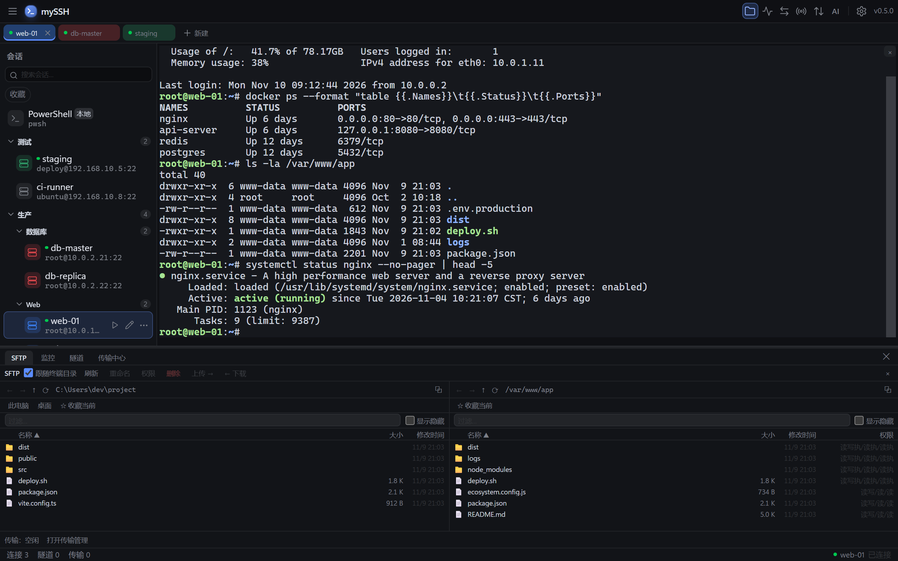
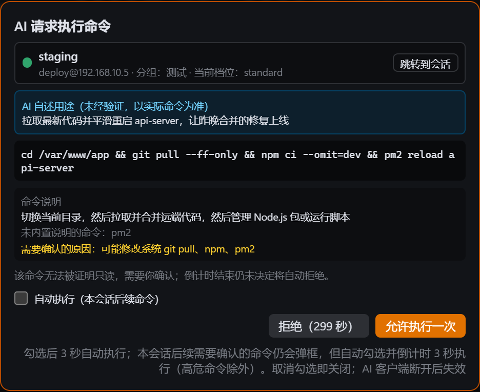
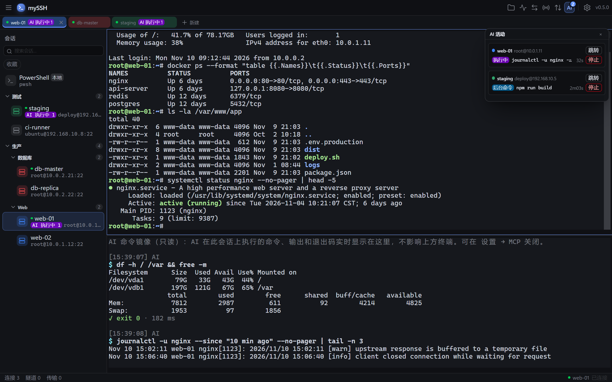
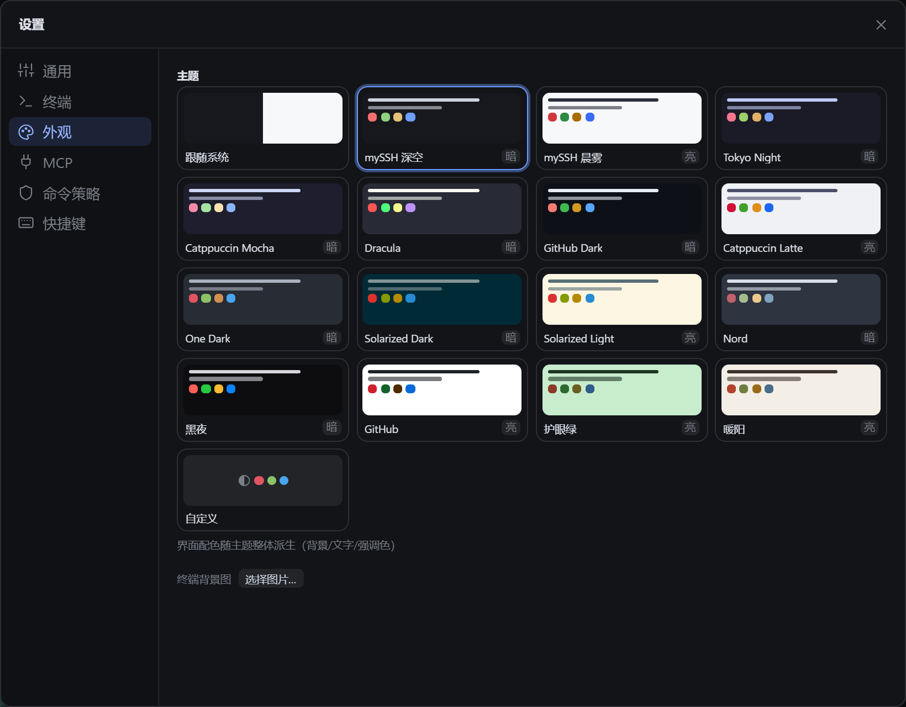

<p align="center">
  
</p>

<h1 align="center">mySSH</h1>

<p align="center">
  <b>A local-first SSH client for Windows, and a safe way to let AI assistants work on your servers.</b>
</p>

<p align="center">
  English | <a href="README.zh-CN.md">简体中文</a>
</p>

<p align="center">
  <a href="https://github.com/AstraNocturna/mySSH/releases/latest"></a>
  <a href="https://github.com/AstraNocturna/mySSH/actions/workflows/ci.yml"></a>
  <a href="LICENSE"></a>
  
</p>



<sub>Screenshots show the Chinese UI. The app also has a full English UI (Settings → General → Language).</sub>

## Why mySSH

- **A capable everyday SSH client**: tabs, split panes, session groups, a dual-pane SFTP file manager, port forwarding and server monitoring, ready out of the box.
- **Hand servers to AI, safely**: a built-in MCP server lets Claude Code, Cursor and other AI assistants troubleshoot, change configs and move files on your servers. Risky commands ask you first, every step is logged, and files the AI changed can be rolled back with one click.
- **Your data stays on your PC**: no account, no cloud. Session configs live locally; passwords and keys are encrypted with Windows' built-in DPAPI and never written to disk in plain text.
- **Fast and steady**: written in Rust, with an installer of about 8 MB. Large transfers and tunnels use their own connections, so they never stall the terminal you're typing in.

## Download

Get the latest `mySSH_x.y.z_x64-setup.exe` (or the `.msi`) from [Releases](https://github.com/AstraNocturna/mySSH/releases/latest) and run it.

- Requires Windows 10 / 11 (64-bit).
- The installer is not code-signed yet. If Windows shows "Windows protected your PC", click "More info → Run anyway".
- Later versions are checked on startup and installed after you confirm.

## Getting started

1. Click "＋ New" on the tab bar, enter host, port and user name, choose password or key login, then click "Save and Connect".
2. Saved sessions appear in the sidebar; double-click one to connect. On first connect you confirm the server's host key.
3. Press `Ctrl+Shift+E` to open the SFTP panel: your PC on the left, the server on the right; drag files across.
4. Press `Ctrl+Shift+P` for the command palette to search sessions and every feature.

Want AI to work on your servers? See [AI integration](#ai-integration-mcp) below.

## Features

**Terminal**
- Tabs and split panes in any direction; drag a tab out into its own window; auto-reconnect.
- True color, wide CJK characters, mouse support, search, hyperlinks.
- Input broadcasting: type once, send to several servers.
- Command snippets: save frequent commands, type a trigger word and press Tab to expand.
- In-terminal file transfer with `rz` / `sz` and trzsz.
- Session recording: record terminal sessions, replay in the built-in player or export as text (keystrokes are not recorded).
- Legacy encodings such as GBK and Big5.

**Sessions**
- Nested groups, tags, favorites, fuzzy search.
- Password, key (OpenSSH and PuTTY `.ppk`), two-factor and SSH agent login.
- Multi-hop jump hosts (ProxyJump).
- Run commands automatically after login; log in as a regular user and switch to root automatically.
- Local terminals: PowerShell, pwsh and CMD side by side with SSH sessions.

**Files and network**
- Dual-pane SFTP: drag between your PC and the server, or straight in from Explorer.
- Transfer queue with concurrency control, resume, retry and history.
- Edit remote files directly; saving uploads them.
- The file panel can follow the terminal's current directory.
- Port forwarding: local, remote and SOCKS5, can start with the session and recover after disconnects.
- Server monitoring: live CPU, memory, disk and network charts plus top processes.

**Look and more**
- 15 built-in themes that recolor the whole UI; a visual custom theme editor and terminal background images.
- English and Chinese UI.
- Export and import configs, optionally passphrase-encrypted.
- One-click diagnostics bundle for bug reports.

## AI integration (MCP)

Enable the server under Settings → MCP, click "Copy config for" and paste the config into your AI client. The AI then gets 31 tools: run commands, background jobs, ops recipes, interactive terminals, read, write and edit remote files, upload and download.

You stay in control:

- **Per-session permissions**: everything allowed on test boxes, view-only on production.
- **Risky commands ask you first**: every command is analyzed before it runs. When approval is needed, a popup shows which server, what the command does and why it needs approval, with focus on "Deny".

<p align="center">
  
</p>

- **See what the AI is doing**: commands the AI runs and their output appear live in a read-only pane under the terminal. The "AI" toolbar button lists everything in progress, each with a stop button.
- **Traceable afterwards**: every action goes into a tamper-evident audit log, AI-controlled terminals are recorded, and files the AI changed can be rolled back with one click.
- **Disconnect means hands off**: when the AI client closes, its unfinished commands, pending requests and open terminals are cleaned up automatically.



For the tool list, permission rules and command policy, see the [AI integration guide](guide/ai-mcp.en.md).

## Themes



## Build from source

Requires Rust stable, Node.js 20+, Windows 10/11 (WebView2 Runtime).

```bash
# Frontend
cd app/ui
npm install
npm run build

# Desktop app (output: target/release/app.exe)
cargo build -p app --release

# Installers, NSIS + MSI (run in crates/app; output: target/release/bundle/)
cd crates/app
../../app/ui/node_modules/.bin/tauri.cmd build
```

Dev mode with hot reload:

```bash
cd app/ui && npm run dev        # Vite dev server
cargo run -p app                # in another terminal
```

## Contributing

Please make these checks pass before submitting (same as CI):

```bash
# Rust (repo root)
cargo fmt --all -- --check
cargo clippy --workspace --all-targets -- -D warnings
cargo test --workspace

# Frontend (app/ui)
npm run lint
npm test
```

Engineering rules: no `unwrap` / `expect` outside tests (exceptions need a `// SAFETY:` comment), no `unsafe`.

Tech stack: Tauri 2 (Rust + WebView2), React 19 + TypeScript + Tailwind 4, xterm.js 6, russh, SQLite.

```
crates/
  app/          Tauri shell: commands, IPC, MCP server
  core-ssh/     SSH connections, auth, channels
  core-tunnel/  Port forwarding
  core-sftp/    SFTP and transfer queue
  core-monitor/ Server metrics
  core-store/   Local storage, credential vault, import/export
  core-policy/  AI command policy
  cli/          Command-line tool (planned)
app/ui/         Frontend (React + xterm)
```

## Where your data lives

Everything is under `%LOCALAPPDATA%\myssh\`:

- `myssh.db`: sessions, tunnels, transfer history and other settings (SQLite);
- credentials: encrypted with Windows DPAPI, readable only by the current Windows user on this PC;
- `known_hosts`: confirmed server host keys;
- `logs/`: application logs.

## Roadmap

- Command-line tool: script mySSH from the command line.
- Bastion navigation: drive menu-style bastion hosts such as JumpServer to reach target servers.

## License

[MIT](LICENSE)
