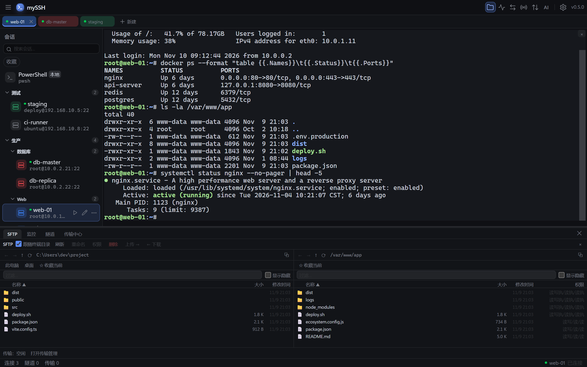
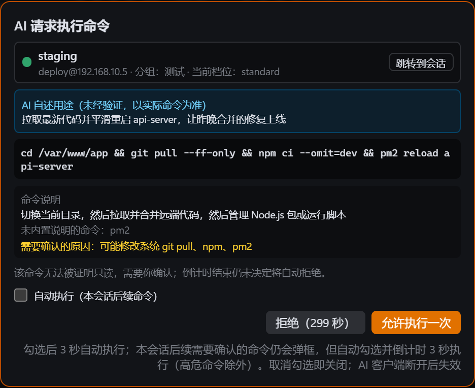
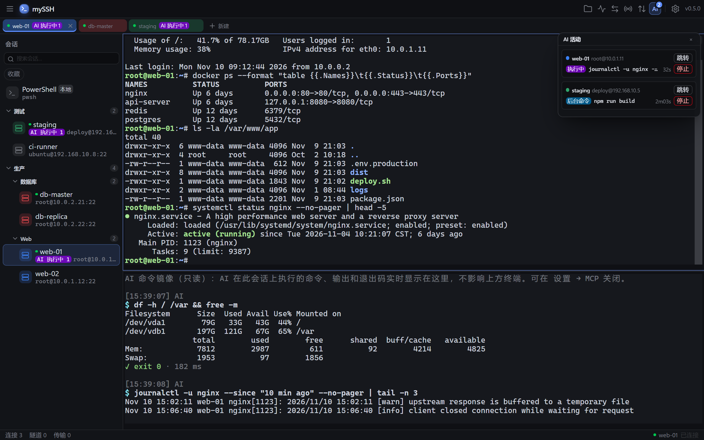
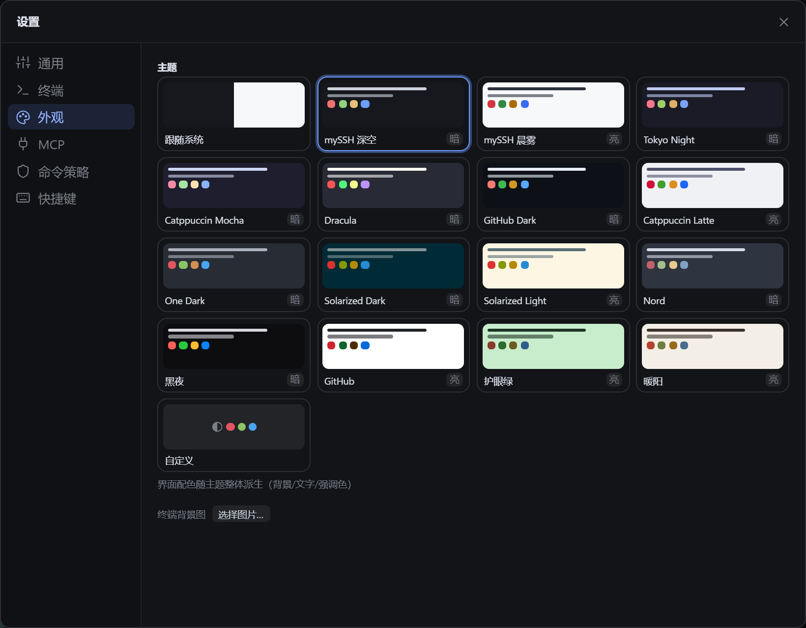

<p align="center">
  
</p>

<h1 align="center">mySSH</h1>

<p align="center">
  <b>给 Windows 用的本地 SSH 客户端，也是 AI 助手操作服务器的安全入口。</b>
</p>

<p align="center">
  <a href="README.md">English</a> | 简体中文
</p>

<p align="center">
  <a href="https://github.com/AstraNocturna/mySSH/releases/latest"></a>
  <a href="https://github.com/AstraNocturna/mySSH/actions/workflows/ci.yml"></a>
  <a href="LICENSE"></a>
  
</p>



## 为什么选 mySSH

- **好用的日常 SSH 客户端**：多标签、分屏、会话分组、SFTP 双栏文件管理、端口转发、服务器监控都有，打开就能用。
- **把服务器安全地交给 AI**：内置 MCP 服务端，Claude Code、Cursor 等 AI 助手可以直接在你的服务器上查问题、改配置、传文件。危险命令先弹框问你，每一步都有记录，改坏的文件能一键回滚。
- **数据只在你的电脑上**：不用注册登录，不依赖云端。会话配置存在本机，密码和私钥用 Windows 自带的加密机制保存，从不明文写到磁盘。
- **快而稳**：Rust 编写，安装包约 8 MB。传大文件、开隧道都走独立连接，不会卡住你正在用的终端。

## 下载安装

到 [Releases](https://github.com/AstraNocturna/mySSH/releases/latest) 下载最新的 `mySSH_x.y.z_x64-setup.exe`（也提供 `.msi`），双击安装。

- 系统要求：Windows 10 / 11（64 位）。
- 安装包暂未做代码签名，Windows 可能提示「Windows 已保护你的电脑」，点「更多信息 → 仍要运行」即可。
- 之后的新版本会在启动时自动检查，确认后自动下载安装。

## 快速上手

1. 点标签栏上的「＋ 新建」，填写主机、端口、用户名，选择密码或密钥登录，点「保存并连接」。
2. 保存过的会话会出现在左侧列表，以后双击就能连接。首次连接会让你确认服务器指纹。
3. 按 `Ctrl+Shift+E` 打开 SFTP 面板，左边是本机，右边是服务器，拖拽就能传文件。
4. 按 `Ctrl+Shift+P` 打开命令面板，可以搜索会话和所有功能。

想让 AI 帮你操作服务器？看下面的 [AI 接入](#ai-接入mcp)。

## 功能

**终端**
- 多标签、任意方向分屏，标签可以拖出去变成独立窗口；断线自动重连。
- 支持真彩色、中文等宽字符、鼠标操作、搜索、超链接。
- 输入广播：一次输入同时发到多台服务器。
- 命令片段：常用命令存起来，输入触发词按 Tab 展开。
- 终端内传文件：支持 `rz` / `sz` 和 trzsz。
- 会话录像：录下终端操作，可在内置播放器回放或导出文本（不录键盘输入）。
- 支持 GBK、Big5 等编码的老服务器。

**会话管理**
- 多级分组、标签、收藏、模糊搜索。
- 密码、密钥（OpenSSH 和 PuTTY `.ppk`）、两步验证、SSH Agent 登录。
- 多级跳板机（ProxyJump）。
- 登录后自动执行命令；可以用普通账号登录后自动切换到 root。
- 本地终端：PowerShell、pwsh、CMD 和 SSH 会话放在一起用。

**文件与网络**
- SFTP 双栏文件管理：本机和服务器之间互相拖拽，也能直接从资源管理器拖进来。
- 传输队列：并发控制、断点续传、失败重试、传输历史。
- 直接编辑远程文件，保存后自动上传。
- 文件面板可以跟随终端的当前目录。
- 端口转发：本地、远程、SOCKS5 动态转发，可随会话自动启动，断线自动恢复。
- 服务器监控：CPU、内存、磁盘、网络实时图表和进程排行。

**外观与其他**
- 15 套内置主题，整个界面跟着换色；可以图形化自定义主题、设置终端背景图。
- 中文 / 英文界面。
- 配置导出导入，可以设置口令加密。
- 一键导出诊断包，方便提交问题。

## AI 接入（MCP）

在「设置 → MCP」开启服务端，点「一键复制配置」粘贴到 AI 客户端，AI 就能使用 31 个工具：执行命令、后台任务、运维模板、交互式终端、读写和编辑远程文件、上传下载。

AI 能做什么由你决定：

- **按会话分配权限**：测试机全部放开，生产机只让看不让改。
- **危险命令先问你**：每条命令执行前都会分析风险。需要确认时弹出授权框，标明是哪台服务器、命令要做什么、为什么需要确认，默认焦点在「拒绝」。

<p align="center">
  
</p>

- **看得见 AI 在做什么**：AI 执行的命令和输出实时显示在终端下方的只读分屏里。点工具栏的「AI」按钮可以看到所有进行中的操作，每项都能一键停止。
- **事后可追溯**：所有操作写入防篡改的审计日志，AI 操作的终端自动录像，AI 改过的文件可以一键回滚。
- **AI 断开就收手**：AI 客户端关闭后，它没做完的命令、待确认的请求和打开的终端会自动清理。



工具列表、权限规则、命令策略等完整说明见 [AI 接入说明](guide/ai-mcp.md)。

## 主题



## 从源码构建

需要 rustup（Rust 版本由仓库根目录的 `rust-toolchain.toml` 固定，首次编译时自动安装）、Node.js 20+、Windows 10/11（WebView2 Runtime）。

```bash
# 前端
cd app/ui
npm install
npm run build

# 桌面应用（产物：target/release/app.exe）
cargo build -p app --release

# 安装包 NSIS + MSI（在 crates/app 下执行，产物：target/release/bundle/）
cd crates/app
../../app/ui/node_modules/.bin/tauri.cmd build
```

开发模式（热更新）：

```bash
cd app/ui && npm run dev        # Vite 开发服务器
cargo run -p app                # 另开一个终端
```

## 参与开发

提交前请跑通以下检查（与 CI 一致）：

```bash
# Rust（仓库根目录）
cargo fmt --all -- --check
cargo clippy --workspace --all-targets -- -D warnings
cargo test --workspace

# 前端（app/ui 目录）
npm run lint
npm test
```

工程约定：非测试代码不用 `unwrap` / `expect`（例外须附 `// SAFETY:` 注释），不用 `unsafe`。

技术栈：Tauri 2（Rust + WebView2）、React 19 + TypeScript + Tailwind 4、xterm.js 6、russh、SQLite。

```
crates/
  app/          Tauri 壳：命令层、IPC、MCP 服务端
  core-ssh/     SSH 连接、认证、通道
  core-tunnel/  端口转发
  core-sftp/    SFTP 与传输队列
  core-monitor/ 服务器监控采样
  core-store/   本地存储、凭据保险库、导入导出
  core-policy/  AI 命令策略
  cli/          命令行工具（规划中）
app/ui/         前端（React + xterm）
```

## 数据存放位置

所有数据都在 `%LOCALAPPDATA%\myssh\`：

- `myssh.db`：会话、隧道、传输历史等配置（SQLite）；
- 凭据：用 Windows DPAPI 加密，只有当前 Windows 用户在这台电脑上能解开；
- `known_hosts`：已确认的服务器指纹；
- `logs/`：运行日志。

## 路线图

- 命令行工具：用脚本调用 mySSH 的能力。
- 堡垒机导航：自动操作 JumpServer 这类菜单式堡垒机，直达目标服务器。

## 许可证

[MIT](LICENSE)
